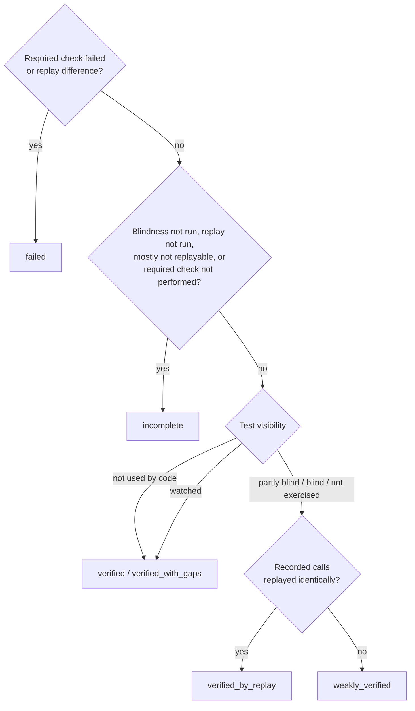

# RepoMedic: Technical Approach

**Track 1 · Gemma 4 · Dependency Resilience**

RepoMedic (engine: `depexit`) finds the risky dependencies of a Python repository, plans
an exit for each one, migrates the code in isolated working copies, and then **proves** the
result through execution. It never trusts a green test run on its own: it also measures
whether the tests could have noticed a broken dependency at all, and replays real
recorded calls against the migrated code. Each exit ends up as a *Dependency Exit Capsule*:
a reusable, evidence-carrying package in which every statement is labelled by where it
came from.

This document explains the whole technical approach: the problem, the design
principles, the pipeline stage by stage, how Gemma 4 is used and constrained, the
verification model, the evidence-quality checks, the execution boundary, the interfaces,
the testing strategy, results on the organizer-provided LinkWatch repository, and the
known limitations.

---

## Contents

1. [Problem](#1-problem)
2. [Design principles](#2-design-principles)
3. [System overview](#3-system-overview)
4. [Stage 1: Inspect (observed)](#4-stage-1-inspect-observed)
5. [Stage 2: Baseline (executed)](#5-stage-2-baseline-executed)
6. [Stage 3: Risk scoring (observed + executed)](#6-stage-3-risk-scoring-observed--executed)
7. [Stage 4: Evidence quality, test blindness and recording](#7-stage-4-evidence-quality-test-blindness-and-recording)
8. [Stage 5: Plan (Gemma 4, validated)](#8-stage-5-plan-gemma-4-validated)
9. [Stage 6: Migrate and verify (executed)](#9-stage-6-migrate-and-verify-executed)
10. [Stage 7: Combine (executed)](#10-stage-7-combine-executed)
11. [Verification model and verdicts](#11-verification-model-and-verdicts)
12. [Gemma 4 integration](#12-gemma-4-integration)
13. [Dependency Exit Capsules](#13-dependency-exit-capsules)
14. [Execution boundary and security](#14-execution-boundary-and-security)
15. [Interfaces: CLI, HTTP API, web workbench](#15-interfaces-cli-http-api-web-workbench)
16. [Testing strategy](#16-testing-strategy)
17. [Results on LinkWatch](#17-results-on-linkwatch)
18. [Limitations and future work](#18-limitations-and-future-work)
19. [Code map](#19-code-map)

---

## 1. Problem

Dependency upgrades and replacements fail in three quiet ways:

1. **The risk is invisible.** It hides in drift between manifests, undeclared transitive
   imports, monkeypatched internals, deprecated APIs that only warn, or a pinned version
   that no longer imports on a newer Python.
2. **The migration is unverified.** "The tests pass" is treated as proof, even when the
   tests never touch the code that uses the dependency.
3. **AI output is trusted.** An LLM can invent a package, a version, or an API mapping,
   and confidently rewrite code that still imports the old library.

RepoMedic addresses all three: it makes risk observable, makes migration evidence
executable, and keeps the model on a short, checked leash.

## 2. Design principles

| Principle | What it means in the code |
|---|---|
| **Evidence over assertion** | Every capsule field carries a provenance: `observed` (repository or public metadata, with its source), `executed` (produced by running something, with command and log), `ai_generated` (Gemma, with model and prompt hash), or `rule_based` (deterministic fallback). |
| **A skipped check is never a pass** | Requirements evaluate to `met`, `failed` or `not_checked`. A required check that was not performed makes the result `incomplete`, never `verified`. |
| **Measure the strength of the evidence** | Tests that cannot see a dependency cannot verify its migration. RepoMedic measures that blindness and compensates with replay of real recorded calls. |
| **AI proposes, the tool disposes** | Gemma writes proposals, mappings, code, probes and reviews. Deterministic code validates all of it and alone decides pass/fail. |
| **Isolation by default** | Every migration runs in its own working copy. The analysed repository is never modified. |
| **Reuse the real engine** | The CLI, HTTP API and UI all drive the same `Pipeline`; the UI renders backend capsules and never invents results. |
| **Local-first** | Gemma 4 runs locally through Ollama; the UI refuses non-local model endpoints. |

## 3. System overview

```mermaid
flowchart LR
    T[Target repo<br/>URL or path] --> I[Inspect<br/>manifests + AST usage]
    I --> B[Baseline<br/>venv per Python, pytest]
    B --> R[Risk scoring<br/>PyPI · GitHub · executed signals]
    R --> E[Evidence quality<br/>test blindness + recording]
    E --> P[Plan<br/>Gemma 4 + validation]
    P -->|human review| M[Migrate<br/>working copy per dependency]
    M --> V[Verify<br/>install · tests · probes · replay · residual]
    V -->|failures as feedback| M
    V --> C[Combine<br/>3-way merge + re-verify]
    C --> X[Capsules<br/>JSON · Markdown · patch · logs]
```



The `Pipeline` class (`depexit/pipeline.py`) exposes each stage separately:

| Method | Stages | Modifies code? |
|---|---|---|
| `analyze()` | inspect, baseline, risk, evidence quality | no (copies only) |
| `plan_all()` | plan | no |
| `run_exits(names)` | migrate, verify, fix loop | working copies only |
| `finalize()` | combine, write capsules | working copies only |
| `execute()` | all of the above (the CLI) | working copies only |

The web workbench stops after `plan_all()` so a human can review the plans before any
code is touched. Every stage reports progress through `Pipeline.say()`, which feeds both
the CLI log and the live event stream in the UI.

## 4. Stage 1: Inspect (observed)

**Manifests** (`manifests.py`) parses `requirements*.txt`, `requirements/*.txt` and PEP 621
`pyproject.toml` (dependencies, optional extras, dependency groups and build requires).
Commented-out requirements are recognised but marked `commented`, and option lines and
inline comments are handled. **Drift detection** flags a distribution that is declared
differently in two files, and marks it *incompatible* when one file's pinned version does
not satisfy the other file's specifier (for example, LinkWatch's `pydantic==1.10.13` vs
`pydantic>=2`).

**Usage** (`usage.py`) is an AST visitor that resolves:

- aliases: `import requests as rq`, `from requests import Session as S`;
- attribute chains: `rq.adapters.HTTPAdapter` → `requests.adapters.HTTPAdapter`;
- calls, references, subclassing and **monkeypatching** (`requests.Session.request = …`);
- private API access (`requests.utils._parse_content_type_header`);
- the **enclosing function** of every site, as a Python `__qualname__`
  (`Cache.path`, `outer.<locals>.inner`). Stage 4 replays these functions.

Standard-library and repository-local modules are excluded. Build and CI files (Makefile,
Dockerfile, tox, GitHub workflows) are scanned for console scripts and `python -m`
invocations of each distribution, which catches tooling-only usage such as `nosetests`.

## 5. Stage 2: Baseline (executed)

For each target Python (default 3.12 and 3.13), `sandbox.create_env` creates a fresh
`uv` virtual environment and installs the project the way the repository expects it:
requirements files if present, otherwise `-e .`. A helper running *inside* the venv
(`_helpers/pkgmap.py`) reports the installed distributions, their import names, console
scripts and requirements. This gives the exact module → distribution map needed for
attribution.

The test suite runs with JUnit XML output and a warnings-capture plugin
(`_helpers/depexit_warnings.py`), so the baseline records the per-test outcome, every
warning with its origin, and collection errors. Import checks
(`_helpers/import_check.py`) verify that every used module imports, and capture any
warnings raised on import.

## 6. Stage 3: Risk scoring (observed + executed)

`risk.py` turns facts into indicators, each with evidence and severity:

| Source | Indicators |
|---|---|
| Repository (observed) | manifest drift, undeclared-but-imported, declared-but-unused (noting the parent that still pulls it in), build tool pinned at runtime, private API, monkeypatching, commented requirements |
| PyPI and GitHub (observed) | known vulnerabilities of the installed version, yanked release, inactive classifier, no release in 3+ years, archived repository, major versions behind |
| Baseline (executed) | `import` fails, deprecation on import, test collection broken by the package, tests failing *inside* the package (attributed via traceback frames), deprecation warnings during tests |

Indicators are de-duplicated across Pythons and scored with `2^severity`. Dependencies
with at least a medium indicator are selected for an exit. Metadata fetches retry
transient network errors and are cached on disk, so repeated runs are fast and
reproducible.

## 7. Stage 4: Evidence quality, test blindness and recording

This stage answers a question most tools never ask: **could the original tests detect a
broken dependency at all?**

### 7.1 Test blindness (`blindness.py`, `_helpers/depexit_sabotage.py`)

For each selected dependency, the most-used symbols in non-test code are sabotaged one
at a time, and the **original** suite is re-run in the baseline venv:

| Mode | Behaviour |
|---|---|
| `raise` | the symbol raises `RuntimeError("depexit sabotage")` (classes: `__init__` raises) |
| `none` | it returns `None` |
| `wrong` | it returns a wrong value of the real value's type (`"__depexit_wrong__"`, `{}`, `[]`, `-999`, `not b`) |

Implementation details that matter:

- The pytest plugin patches the symbol in `pytest_load_initial_conftests`, so before
  `conftest.py` and test modules import the code. It then **rebinds** names already copied
  into repository modules by `from x import y`, by walking `sys.modules` for modules
  under the repository root.
- It counts calls and flushes its state on the first call. A pytest crash *caused by* the
  sabotage (for example, a sabotaged `pydantic.validator` decorator raising at import)
  therefore counts as detection, not as an infrastructure failure.
- A helper (`symbol_info.py`) classifies each symbol (callable, class or constant)
  beforehand, so only meaningful modes run.
- Runs execute in parallel, each in its own repository copy, with a timeout.

A test "catches" a sabotage if it passed in the baseline and fails, errors, or
disappears under sabotage. A new collection error also counts. Classification:

| Result | Rule |
|---|---|
| `watched` | every exercised mode was detected by at least one test |
| `partly_blind` | some modes detected, some not |
| `blind` | no mode detected |
| `not_exercised` | the sabotaged symbols were never called (call count 0) |
| `not_run` | the check could not run (reason recorded); never treated as watched |
| `not_applicable` | the dependency is not used by repository code |

### 7.2 Recording real calls (`replay.py`, `_helpers/depexit_record.py`)

Replay targets are the **repository's own functions that contain dependency usage**,
found through the enclosing-function information from stage 1. Their names and signatures
survive a migration, so no API translation is needed to call them again. Targets are
skipped (and listed) when replay would be unsafe or impossible:

- **network I/O**, detected through resolved symbols that open connections
  (`requests.get`, `requests.Session`, `urllib.request`, `socket`, `httpx`, …) and
  **propagated through repository-local calls**, including relative imports. LinkWatch's
  `check_site` is skipped because it calls `fetch`. Pure helpers such as
  `requests.utils.*` are not network I/O;
- async functions, generators, decorated functions (e.g. click commands, where the
  module attribute is not the plain function) and nested functions.

One extra run of the original suite wraps those functions. Every call becomes a JSONL
record: the function, the triggering test's node id, the base64 pickle of `(args, kwargs)`,
and the normalised output or exception type. Identical inputs are de-duplicated and each
function is capped at 200 calls. Calls whose inputs or outputs cannot be pickled are kept
as `not_replayable`, with the reason.

## 8. Stage 5: Plan (Gemma 4, validated)

For each dependency, Gemma receives the observed facts (declarations, installed versions,
PyPI summary, risk indicators, usage sites) and the source of the files that use it. It
chooses one action: `upgrade`, `replace`, `stdlib`, `remove`, `declare` or `keep`. It
returns a package and specifier, migration steps, an **API mapping** and risks.

Every claim is then checked deterministically (`ai.validate_plan`):

| Check | Blocking? |
|---|---|
| the action is one of the six | yes |
| the package exists on PyPI **and** a version satisfying the specifier supports every target Python | yes |
| the stdlib module exists in `sys.stdlib_module_names` on every target Python | yes |
| the replacement differs from the original | yes |
| the API mapping has `old`/`new` entries when the code uses the dependency (replace/stdlib) | yes |
| mapped replacements do not still use the old dependency | yes |
| every mapped `old` symbol is actually used | advisory |
| the mapping covers every observed symbol | advisory |
| the migration steps are a list of strings | advisory |

If a blocking check fails, the plan is rejected (kept in the capsule as
`rejected_ai_plan`) and the rule-based plan takes over. Advisory failures become
**uncertainties** shown in the capsule and UI. The API mapping is cross-checked against
the AST usage map (`ai.review_api_mapping`): each entry lists the file:line sites it
covers, and each observed symbol without a mapping is listed as *unmapped*.

The plan also fixes the **verification requirements before anything runs** (section 11),
and Gemma writes **behaviour probes**: zero-argument callables that exercise the
repository's own functions on edge cases. Probes are AST-checked to define `PROBES` and
to avoid socket/subprocess/shutil/ctypes imports.

Without a model (`--no-llm`, or model unreachable), `ai.rule_based_plan` handles the
deterministic cases: remove unused, declare undeclared, upgrade to the latest version
compatible with all target Pythons (capped below the next major).

## 9. Stage 6: Migrate and verify (executed)

Each dependency gets its own working copy (`.work/deps/<dep>/attempt<N>/repo`):

1. **Manifests are edited by the tool, never by the model**: replace, remove or add the
   requirement in every manifest that declares it.
2. **Code is rewritten by Gemma** when needed. The output must use `### FILE:` blocks and
   is validated per file: the path stays inside the repo, the file was given to the model,
   the file exists, it parses, and it adds no **unplanned third-party imports** (allowed:
   stdlib, repo-local, already installed, the planned package).
3. A **residual re-scan** of the migrated tree checks that no Python code still uses a
   removed or replaced dependency. Tooling references are reported separately.
4. On **every target Python**, verification creates a new venv, installs, runs the full
   suite, compares warnings, import-checks the replacement, and runs the probes on both
   the original and the migrated code.
5. **Replay** (first target Python, the same one used for recording): the recorded calls
   run through `replay_runner.py`, first in the original env (**control**), then in the
   migrated env. If the control disagrees with the recording, the call depended on test
   context (fixtures, monkeypatching), so it is reported as `not_replayable` instead of
   being compared. Outputs are normalised (repo, venv, home and temp paths, memory
   addresses, key order) and classified `identical`, `different`, `exception_changed`
   (exceptions match by type) or `not_replayable`.

**Fix loop.** If a required check fails or probes or replay differ, the executed evidence
(tracebacks, regressed tests, probe diffs, replay differences with their source test,
leftover imports, install errors) goes back to Gemma, which retries up to
`--max-fix-attempts` times. Every attempt is kept in the capsule.

## 10. Stage 7: Combine (executed)

Every exit that passed individually (`verified`, `verified_with_gaps`,
`verified_by_replay` or `weakly_verified`) is applied to one tree. Manifests are re-edited
deterministically; code edits are merged with a three-way `git merge-file` against the
original. When there is a conflict, Gemma re-applies that migration on top of the combined
code. If that also fails, the exit is rolled back and listed as skipped. The combined
tree is then re-verified on every Python (install, tests vs baseline, warnings) and
re-scanned for residual usage. Exits that were not individually verified are listed in
`excluded_unverified`, so the combined result never hides them.

## 11. Verification model and verdicts

### Requirements (decided at plan time)

| Requirement | Level |
|---|---|
| `install` on every Python | required |
| `suite_runs` (no *new* collection error) | required |
| `no_regressions`: at least one baseline test passed, and every baseline-passing test re-ran and still passes; a test that silently disappears is a regression | required |
| `replacement_imports` | required for upgrade/replace/declare/stdlib |
| `version_satisfies`: the resolver really installed the planned version | required for upgrades |
| `no_residual_code` | required for remove/replace/stdlib |
| `behaviour_probes` identical | **required when code is rewritten**, otherwise advisory |
| `replay_identical` | required once recorded calls were compared |
| `original_uninstalled`, `no_residual_tooling`, `no_new_warnings` | advisory |

Each requirement evaluates to `met`, `failed` or `not_checked`, with evidence. Across
Pythons, `failed` wins over `not_checked`, which wins over `met`.

### Verdict



`verified_with_gaps` means every required check was met but an advisory one failed or did
not run. Every verdict carries a human-readable reason in the capsule, `CAPSULE.md`,
`REPORT.md` and the UI.

## 12. Gemma 4 integration

| Aspect | Approach |
|---|---|
| Model | Gemma 4 through local **Ollama** (developed with `gemma4:e4b`; `gemma4:26b` or `31b` recommended for quality) |
| API | Ollama is auto-detected (`/api/version`) and driven through its **native `/api/chat`** with an explicit `num_ctx` (default 8192) and thinking disabled. Ollama's OpenAI-compatible endpoint silently truncates to the server default context (4096 tokens on our machine), so a prompt that fills the window is raised as an error rather than truncated. Other OpenAI-compatible servers are supported by the CLI. |
| Connectivity | `GET /models` checks real availability; a ping verifies generation. If the model is unavailable, the run proceeds deterministically and the UI lists the disabled AI features. |
| Prompts | Narrow and checkable (`prompts.py`): proposal JSON, file blocks, a probe module, review JSON. A system prompt forbids invented packages and APIs. |
| Traceability | Every call is logged to `llm_calls/NNN_<purpose>.json` with prompt, response, model, prompt SHA-256, latency and token usage, and referenced from the capsule. |
| What Gemma never does | edit manifests, decide pass/fail, or produce `observed`/`executed` fields |

## 13. Dependency Exit Capsules

```
<out>/
  REPORT.md · index.json · combined/all-migrations.patch
  capsules/<dep>/
    capsule.json   CAPSULE.md   migration.patch   probes.py   probe_runner.py
    logs/original-py*.log   logs/replacement-py*.log   replay.sh
  llm_calls/*.json
```

`capsule.json` (schema `dependency-exit-capsule/1.0`) contains: dependency details;
risk indicators with evidence; usage locations; the proposed replacement with its API
mapping review; migration steps; validation of AI output; **verification requirements and
results**; **test blindness** (runs, call counts, catching tests); **replay** (counts,
every difference with input, original output, replacement output and source test,
not-replayable and skipped lists, AI-generated extra inputs reported separately); executed
test results per Python; compatibility gaps; AI review; open concerns. `replay.sh`
re-runs original-vs-replacement verification from scratch on any checkout. The full
reference is in [capsule-format.md](capsule-format.md).

## 14. Execution boundary and security

RepoMedic must run untrusted code (install hooks, tests, probes) to verify anything. It is
explicit about what it protects and what it does not:

| Control | Implementation |
|---|---|
| Working copies | every baseline, sabotage run, recording, attempt and combine uses its own copy; the target is never written |
| Environment scrubbing | repository code gets an **allowlisted** environment (`util.SAFE_ENV_KEYS`): API keys, tokens, `DEPEXIT_LLM_*` and credential-bearing proxy URLs are removed; HOME, TMP and caches point into the run directory |
| Timeouts | on every install, test run, sabotage run, replay and probe run |
| Target validation | https or `git@` URLs only; option-like targets are refused; `git clone -- <url>` without submodules; local paths in the UI must be inside `DEPEXIT_ALLOWED_ROOTS` |
| AI output validation | path containment, given-files-only, parse checks, no unplanned imports, probe import bans |
| Web server | binds to `127.0.0.1`, rejects foreign `Host` headers (DNS rebinding), accepts JSON-only POSTs (CSRF), serves only capsule artifacts, refuses non-local model endpoints, applies patches only to fresh working copies |
| Honesty | each run requires an explicit acknowledgement, and every report states the boundary |

**Not provided: OS-level isolation.** Virtual environments are not a security boundary,
so repository code can read files and use the network as the user. For untrusted
repositories, run RepoMedic inside a disposable VM or container (see
[SECURITY.md](../SECURITY.md)).

## 15. Interfaces: CLI, HTTP API, web workbench

**CLI**: `repomedic analyze <url|path> [-p 3.12 -p 3.13] [--only NAME] [--no-llm] [--jobs N] [--max-fix-attempts N]`
and `repomedic serve`. `depexit` is an identical alias.

**HTTP API** (Flask, `server.py`): start a run, poll live events, review plans, execute
selected or re-run dependencies, fetch capsules and artifacts, and apply a patch to a fresh
working copy. Reference: [http-api.md](http-api.md).

**Web workbench** (vanilla HTML/CSS/JS, beige and brown palette, light and dark):

- the analyse form with a real Gemma status pill and an execution acknowledgement;
- a live stage stepper and event log, summary tiles, and the baseline table;
- a **migration graph** (SVG): dependency → strategy → individual verdict → combined
  result, with edges coloured by status;
- the **risk explorer**: severity bars, indicators, a *Test visibility* badge with catching
  tests, the plan, the status, select-all, and migrate or re-verify of selected
  dependencies;
- the combined-migration panel;
- a **capsule drawer** with Overview, Usage, Risk, Plan (API mapping vs observed sites,
  validation, requirements), Verification (verdict, sabotage table, **replay table with
  differences in red**, per-Python results, fix loop), Gaps, and Proof (artifacts, model
  calls, patch viewer, apply to a working copy);
- runs from earlier server sessions load read-only.

Details: [web-ui.md](web-ui.md).

## 16. Testing strategy

60 deterministic tests, with no network and no real model:

| Layer | Technique |
|---|---|
| Parsing and usage | synthetic repositories (aliases, monkeypatching, private API, drift, editing) |
| AI validation | `FakeHttp` (canned PyPI JSON) and `FakeLLM` (fixed model replies): hallucinated packages, Python-incompatible versions, mappings that still use the old library, unsafe edits |
| Verification semantics | every requirement and verdict, including **migration fails verification**, **install-only is not verified**, **incomplete verification**, **individual pass but combined fails** |
| Pipeline and API | the real `Pipeline` and Flask API over a scripted execution layer (`fake_exec`): plan → review → execute → re-run → capsule → apply; request guards; read-only disk runs |
| Blindness and replay | **real pytest subprocesses** on a fixture repository with two local libraries: watched vs env-var short-circuited (`not_exercised`), a crashing check (`not_run` → `incomplete`), a replacement that changes one recorded output (`different` → `failed`), an unpicklable argument (`not_replayable`, never verified) |

CI runs the suite on Ubuntu and Windows with Python 3.11–3.13, plus a JavaScript syntax
check.

## 17. Results on LinkWatch

Target: `https://github.com/rishrek/LinkWatch` @ `f52f3930c8`, on Python 3.12 and 3.13. The
results below come from real runs on a Windows laptop with a 4 GB GPU and `gemma4:e4b`.

**Baseline:** 9 passed, 1 failed on both Pythons.

**Risk:** 11 at-risk dependencies: jinja2 and nose (critical: import fails on 3.12+),
setuptools, pydantic (manifest drift `==1.10.13` vs `>=2`), requests (vulnerabilities,
private API, monkeypatch), idna, toml, appdirs, six, chardet and certifi.

**Test blindness** (no-LLM run, 4 min 34 s end to end):

| Dependency | Visibility | Evidence |
|---|---|---|
| toml | watched | all 3 modes caught by `tests/test_config.py::test_sites_file_loads` |
| chardet | watched | caught by `test_latin1_title`, `test_missing_is_down` |
| requests | watched | 7 catching tests |
| pydantic | watched | sabotaging `validator` breaks test start-up (11 tests) |
| certifi | **partly blind** | only `raise` is caught; returning `None` or a wrong CA path is not, because the tests use plain http |
| appdirs | **not exercised** | `user_cache_dir` is called 0 times by the tests |
| setuptools | **not exercised** | `pkg_resources.resource_filename` is never called by tests |
| jinja2 | not run | the pinned jinja2 2.11.3 cannot even be imported on 3.12 |
| six, idna, nose | n/a | not used by repository code |

**Replay:** the most important finding. The rule-based upgrade `chardet 5.2.0 → 7.6.0`
**passes the entire test suite**, but replaying a real recorded call shows that
`linkwatch.encoding.detect_encoding` on the cp1252 test page (recorded in
`tests/test_checker.py::test_latin1_title`) now returns **`Windows-1252` instead of
`ISO-8859-1`**. The verdict is therefore **failed**, with that difference in the capsule
and in the fix-loop feedback. The tests watch chardet (sabotage is caught), yet they do
not catch this behaviour change. Only replay of real data does.

**Verdicts (no-LLM run):** requests verified with gaps (5 recorded calls identical);
pydantic, six and idna verified with gaps; certifi **weakly verified** (partly blind,
nothing replayable); jinja2 **incomplete**; setuptools **failed** (`pkg_resources` was
removed in setuptools ≥ 80, which breaks test collection); chardet **failed by replay**.
The combined migration of pydantic, requests, idna, six and certifi was re-verified on
both Pythons with 10/10 tests passing (the previously failing test is fixed).

**With Gemma 4 (full run through the web workbench, before the evidence-quality features
existed):** planning 11 dependencies took about 36 minutes (roughly 6 tokens/s). Gemma
proposed replacing nose with pytest and appdirs with platformdirs, upgrades for the
others, removing six and declaring certifi. Its toml proposal was **rejected by
validation**. Results: jinja2, nose, idna, six, chardet and certifi verified with gaps;
setuptools, pydantic and appdirs **incomplete** (code was rewritten but no valid behaviour
probes could run); requests **failed** after two fix-loop attempts with 1.4 KB and 8 KB of
execution evidence. The combined migration of six exits passed 10/10 on both Pythons.

A scoped Gemma run with the new checks (chardet, appdirs, toml, setuptools) reproduced the
blindness results (toml and chardet watched, appdirs and setuptools not exercised). Gemma
proposed setuptools `>=78.1.1,<84` (which keeps `pkg_resources`), toml → `tomli`,
appdirs → `platformdirs` and chardet `>=7.6.0` (44 min 40 s in total). Verdicts:

- **chardet: failed.** Replay found the cp1252 difference. Gemma's fix loop rewrote the code
  twice using the replay evidence and got closer (`ISO-8859-1` → `iso-8859-1`), but the value
  still differs, so it stays failed.
- **toml → tomli: incomplete.** Attempt 0 failed; after Gemma's fix, 1 recorded call replays
  identically and tests pass, but the required behaviour probes could not run.
- **appdirs → platformdirs: incomplete.** Its only recorded call was not replayable.
- **setuptools: incomplete.** The code was rewritten, but no recorded call and no valid probe
  exists to prove behaviour.

None of these was reported as verified, which is the intended behaviour when the evidence
is missing or contradicts the migration.

## 18. Limitations and future work

| Limitation | Direction |
|---|---|
| No OS-level isolation for repository code | optional container backend (Docker/Podman with network disabled during tests) |
| Python only; pip/PEP 621 manifests | Poetry, `setup.cfg`, Pipfile, lock files |
| Blindness and replay use the first target Python only | per-Python recording |
| Replay needs picklable inputs and covers only functions the tests call | record from real application runs; argument factories for unpicklable inputs |
| Network-touching functions are never replayed | record/replay at the HTTP boundary (cassette-style) |
| Probe quality depends on the model; small local models often produce probes that fail validation | probe-repair loop; bigger Gemma variants |
| Vulnerability reachability is not analysed | call-graph reachability of vulnerable functions |
| Makefile/CI references are reported, not rewritten | deterministic tooling rewrites |
| Metadata can be degraded by rate limits (GitHub 403) or DNS failures | authenticated GitHub API; such failures are recorded, never treated as "healthy" |

## 19. Code map

| Path | Role |
|---|---|
| `depexit/pipeline.py` | orchestration and stage API |
| `depexit/manifests.py`, `usage.py`, `metadata.py`, `risk.py` | observed facts and risk |
| `depexit/sandbox.py` | venvs, installs, pytest, helper runners |
| `depexit/blindness.py` | test blindness check |
| `depexit/replay.py` | recording and replay orchestration |
| `depexit/compare.py` | test, warning, probe and replay comparison; fix-loop feedback |
| `depexit/verification.py` | requirements, statuses, final verdict |
| `depexit/ai.py`, `prompts.py`, `llm.py` | Gemma steps, validation, client |
| `depexit/capsule.py` | capsules, index, report, replay script |
| `depexit/server.py`, `depexit/web/` | HTTP API and web workbench |
| `depexit/_helpers/` | code that runs inside target venvs: `pkgmap`, `import_check`, `depexit_warnings`, `depexit_sabotage`, `depexit_record`, `replay_runner`, `probe_runner`, `symbol_info` |
| `tests/` | 60 deterministic tests |
| `docs/` | this document and the reference pages |
